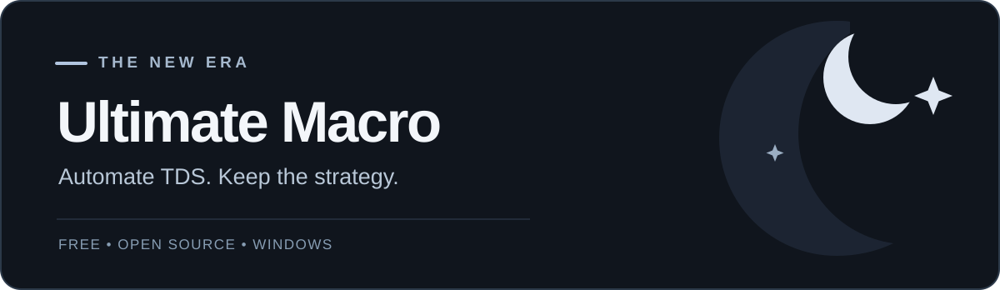
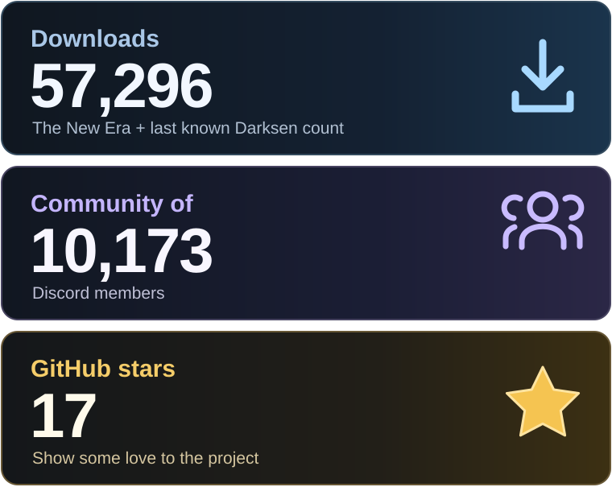

  

  <a href="https://ultmacro.xyz/download"><strong>Download</strong></a>
  &nbsp;&nbsp;·&nbsp;&nbsp; <a href="#getting-started">Get started</a>
  &nbsp;&nbsp;·&nbsp;&nbsp; <a href="https://ultmacro.xyz/wiki/">Wiki</a>
  &nbsp;&nbsp;·&nbsp;&nbsp; <a href="https://discord.gg/ultmacro">Discord</a>

  
  
  
  

  

  <strong>Version 1.4.2</strong> &nbsp;·&nbsp;
  <strong><a href="../LICENSE-1.4.txt">Source available</a></strong> &nbsp;·&nbsp;
  <strong><a href="https://github.com/UltimateMacro/Ultimate-Macro-New-Era/releases">Official releases</a></strong> &nbsp;·&nbsp;
  <strong><a href="#credits">Community-made</a></strong>

# Ultimate Macro

Ultimate Macro helps you repeat strategies in **Roblox Tower Defense Simulator (TDS)**. Choose a strategy made by the community, or record your own. The macro can replay the actions, help prepare the match, and repeat runs while you do something else.

It is a free Windows app. It uses your mouse and keyboard and reads what is on your screen to recognize game menus and results. It does not inject code into Roblox.

> **New here?** Start with the [setup guide](https://ultmacro.xyz/guide/). Stay and watch your first full match so you can check that the strategy and your game settings line up.

## What can Ultimate Macro do?

A **strategy** is a saved set of steps for a match: which towers to place, where to place them, and what actions to take as the game continues.

### Record your own strategy

Play a match and record supported actions such as placing, upgrading, selling, or changing the target of towers. You can also record camera alignment, DJ track changes, supported abilities, and movement. Optional raw mouse and keyboard input can be recorded while Roblox is in the foreground. Save the recording as a .strat file and replay it later.

### Replay strategies

Load a strategy from the app, choose the matching map and game mode, and start the run. The macro can place towers, use supported abilities, skip waves, and handle the steps saved in that strategy.

Strategies are made for particular maps, modes, loadouts, and game versions. A strategy that worked before may need an update after TDS changes.

### Repeat and switch between runs

Ultimate Macro can continue after a confirmed win or loss, and it can try to recover from some recognized disconnects. You can also:

- Switch between two strategies after a chosen number of runs or minutes.
- Set a Coins or Gems goal and stop after a match reaches it.
- Use a timescale ticket for 1.5× or 2× gameplay speed where the mode supports it.

The macro can also retry some tower placements, wait when the game says there is not enough cash, and recover from certain recognized results or disconnects. It stops when it cannot confirm an action safely. These options help with longer sessions, but they do not guarantee that a run will never stop or fail. Keep your PC awake and check the first full match before leaving the macro running.

### Prepare the match

Depending on the strategy and your settings, the macro can select the map, vote Ready, equip towers you own, and align the camera. You can also set up wave skipping and supported tower abilities.

Your in-game keybinds, display settings, selected map, and tower loadout need to match the strategy. Check these before starting.

### Collect playtime rewards

When enabled, the macro can open the in-game reward panel, try to claim available playtime rewards, and read the claim count. If it cannot confirm the claim, it checks again later.

### Set up the app for your play style

You can change game and recording hotkeys, input delays, and other macro settings. You can also choose startup and window behavior, keep the macro in the system tray, and save a VIP server link for runs.

### Use optional Discord features

You can connect Discord to receive match results, rewards, screenshots, session statistics, or logs. The optional ULT Bot can report status and stop a run. Starting a run or requesting a screenshot requires its own permission.

Discord features are optional. Review what you enable, and keep webhook links and bot tokens private.

### Open the extra tools

The Tools tab includes separate tools for using the spin wheel and opening consumable crates. They are separate from replaying a strategy.

### Website dashboard

The website Dashboard, including the Strategy Library and Earnings pages, is **unavailable in version 1.4.2**. The app's other features do not require a website account.

For the full feature list and build-specific limits, see the [Features page](https://ultmacro.xyz/features/) and [release notes](https://github.com/UltimateMacro/Ultimate-Macro-New-Era/releases).

## Getting started

### What you need

- A Windows 10 or Windows 11 computer.
- Roblox and Tower Defense Simulator.
- The complete Ultimate Macro ZIP from the [official download page](https://ultmacro.xyz/download/) or [GitHub releases](https://github.com/UltimateMacro/Ultimate-Macro-New-Era/releases).

The setup guide recommends **1920 × 1080 resolution**, **100% Windows display scaling**, and the **English (US) OCR language pack** for the most predictable screen reading. A Mac, phone, or browser cannot run this Windows app directly.

### Install and open it

1. Download the latest release from the official site or GitHub.
2. Extract the **entire ZIP** into its own folder, such as Documents\Ultimate Macro.
3. Open that folder and run **Start Ultimate Macro.cmd**.
4. Keep the files together. Do not run Main.ahk from inside the ZIP or move it by itself.

The launcher uses the compatible AutoHotkey runtime included with the release. You do not need to install AutoHotkey separately when using the launcher.

### Start your first run

1. Open Roblox and join Tower Defense Simulator.
2. Choose a strategy that matches the map, mode, and towers you can use.
3. Check your TDS keybinds and display settings.
4. Start the macro and stay to watch the full match.

If the macro places the wrong tower or misses a step, stop the run and check the strategy, loadout, keybinds, and game update before trying again.

## Is Ultimate Macro safe?

We want people to be able to understand what the app does and decide for themselves. **No software can be promised “100% virus-free” just because its source is available.**

### What the app does

Ultimate Macro runs on your Windows computer. It uses mouse and keyboard input to control the game, and it reads the visible game screen to recognize menus, tower states, and match results. It does not inject code into Roblox.

The source code is available for inspection. The project also contains earlier code and third-party components with their own existing license terms. See [the current source-available license](../LICENSE-1.4.txt) and [the repository license files](https://github.com/UltimateMacro/Ultimate-Macro-New-Era).

### Why might Windows or antivirus warn me?

Some security tools flag programs that automate mouse and keyboard input. AutoHotkey scripts and new or unsigned downloads can also receive warnings because they are unfamiliar to the security tool.

A warning does not automatically mean a file is malware, and it does not automatically mean the warning is wrong. Check the exact file and message.

### What should I do if I see a warning?

1. Make sure you downloaded the file from the [official website](https://ultmacro.xyz/download/) or [official GitHub releases](https://github.com/UltimateMacro/Ultimate-Macro-New-Era/releases).
2. Scan the file with Windows Security. If the release provides a SHA-256 checksum, compare it with your download.
3. Read the warning carefully. An “unrecognized app” message is different from a detection that names specific malware.
4. If you are unsure, stop and ask for help in the [official Discord](https://discord.gg/ultmacro) or [report the issue](https://github.com/UltimateMacro/Ultimate-Macro-New-Era/issues). Include the file name, version, and exact warning.

**Do not turn off Microsoft Defender or SmartScreen, and do not blindly whitelist the whole macro folder.**

### What information can leave my computer?

The basic gameplay automation runs locally. Optional features can send information when you enable and configure them. For example, Discord webhooks can send logs, match results, statistics, or screenshots. Screenshots may show your Roblox username or other things on your screen.

Only enable the reporting features you want to use. Do not post webhook URLs, bot tokens, pairing codes, or unedited private logs in public.

## Troubleshooting

- **The app does not open:** Extract the complete ZIP again and run Start Ultimate Macro.cmd.
- **The macro misses clicks or reads the wrong screen:** Check Windows scaling, Roblox display settings, TDS UI scale, and the strategy's expected loadout.
- **A strategy stops working:** It may need an update for a TDS change. Check the strategy and the latest release notes.
- **You see a Windows warning:** Follow the steps in [Is Ultimate Macro safe?](#is-ultimate-macro-safe); do not disable protection.

For more help, visit the [Wiki](https://ultmacro.xyz/wiki/) or ask in [Discord](https://discord.gg/ultmacro). When reporting a problem, include your macro version, strategy name, what happened, and what you expected. Remove private information from logs and screenshots.

## Credits

Ultimate Macro exists because people created the original project, maintained it, wrote code, translated it, tested it, shared strategies, and helped other players. Thank you to everyone who contributed.

### Original creator

[Darksen](https://github.com/DarksenDev/tds-macro) created the original Ultimate Macro project. The New Era is a community-maintained continuation of that work. The download total shown above includes releases from both repositories.

- [Original project](https://github.com/DarksenDev/tds-macro)
- [Support Darksen](https://www.donationalerts.com/r/darksen1)

### Lead developers

- [aiden](https://discord.com/users/793893403683323945)
- [pizzaroles24](https://discord.com/users/484196858135183380)

### Developers

- [Banana](https://discord.com/users/881277706862481479)
- [darksen](https://discord.com/users/1091284301359890463)
- [hesgly](https://discord.com/users/962960768549130270)
- [jackappleteam](https://discord.com/users/1247230105529618535)
- [Shovel](https://discord.com/users/1339885336918097944)
- [ultimate](https://discord.com/users/1214550725003051018)

### Contributors

- [Anton](https://discord.com/users/603636276947714234)
- [menz.7](https://discord.com/users/768875188506591283)

### Translators

- [! sayrox0_0](https://discord.com/users/805813917313662986)
- [3_14591](https://discord.com/users/1436762436689723462)
- [apanovaha](https://discord.com/users/985210045908254810)
- [Ayden567843](https://discord.com/users/835854770148999249)
- [creeperhouse999](https://discord.com/users/1081550792328216667)
- [Digiton00b1](https://discord.com/users/1242475532180787356)
- [EллioT🏳️‍🌈](https://discord.com/users/1045340086570598490)
- [Flupizinho](https://discord.com/users/784821467498020895)
- [g4m3rsl4y3r](https://discord.com/users/605778001157947414)
- [hazardous_dice](https://discord.com/users/1456882347130753055)
- [Jack/Jane](https://discord.com/users/1366167590304481310)
- [Ka_Demon](https://discord.com/users/1025682158855143424)
- [KUTMAN79](https://discord.com/users/533591765584838663)
- [oasiscboncbon1](https://discord.com/users/1247561636122853489)
- [profesorhenrique21](https://discord.com/users/741406584625692702)
- [RAZE500](https://discord.com/users/782579955891830824)
- [t8Obvm](https://discord.com/users/1071061896154849311)
- [typoxerax](https://discord.com/users/976460534935322664)
- [yz](https://discord.com/users/711444383807045744)

### Early access

- [\[ Cubed \]](https://discord.com/users/1145652680237256724)
- [4EVRNATE](https://discord.com/users/347812695526866944)
- [Banshyyi](https://discord.com/users/1083952267994091560)
- [captain305993](https://discord.com/users/1252647396274339992)
- [chancito](https://discord.com/users/559176460775063559)
- [N](https://discord.com/users/983780083665874964)
- [ninja89614.](https://discord.com/users/822098417332781078)
- [Slay\[Alesso's Edition\]](https://discord.com/users/1435029512860598416)
- [TheElyBot](https://discord.com/users/1020238066037821450)
- [Truck-Kun](https://discord.com/users/245181646893088770)
- [WaryAngel1837](https://discord.com/users/764675906874507285)
- [Zyven](https://discord.com/users/1381795496355696641)

Thank you as well to everyone who shares strategies, reports bugs, tests new builds, and welcomes people in the [Discord community](https://discord.gg/ultmacro).

## Source, license, and community

- **Current project code:** [Ultimate Macro: New Era on GitHub](https://github.com/UltimateMacro/Ultimate-Macro-New-Era).
- **Current source-available license:** [LICENSE-1.4.txt](../LICENSE-1.4.txt). It applies only to the code it covers.
- **Earlier code and third-party components:** Their existing notices and license terms still apply. This release does not change those terms.
- **Releases and changes:** [GitHub releases](https://github.com/UltimateMacro/Ultimate-Macro-New-Era/releases).
- **Guides:** [Ultimate Macro Wiki](https://ultmacro.xyz/wiki/).
- **Community help:** [Discord](https://discord.gg/ultmacro).

Ultimate Macro is an independent community project. It is not affiliated with or endorsed by Roblox Corporation or Paradoxum Games. Automating gameplay may go against game or platform rules and could put your account at risk. Use it responsibly.

