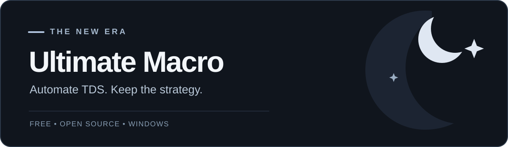
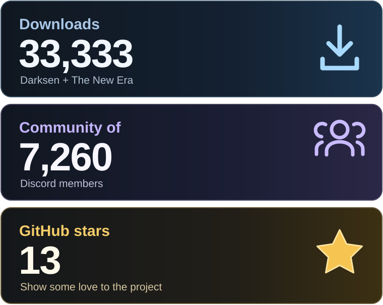
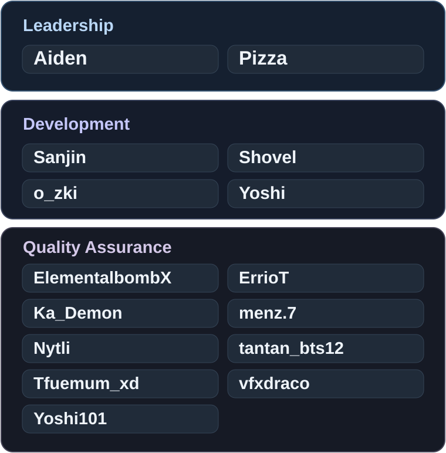

  

  <a href="https://ultmacro.xyz/download"><strong>Download</strong></a>
  &nbsp;&nbsp;·&nbsp;&nbsp; <a href="#getting-started">Get started</a>
  &nbsp;&nbsp;·&nbsp;&nbsp; <a href="https://ultmacro.xyz/wiki/">Wiki</a>
  &nbsp;&nbsp;·&nbsp;&nbsp; <a href="https://discord.gg/ultmacro">Discord</a>

  

<strong><a href="LICENSE">Open source</a></strong> &nbsp;·&nbsp; <strong><a href="https://github.com/UltimateMacro/Ultimate-Macro-New-Era/releases">Official releases</a></strong> &nbsp;·&nbsp; <strong><a href="#the-team">Community-maintained</a></strong>

## What is Ultimate Macro?

**Ultimate Macro** is a free, open-source Windows tool for automating **Roblox Tower Defense Simulator (TDS)**. You can record or import a strategy, then let the macro handle repeatable gameplay actions such as tower placement, upgrades, abilities, and movement between matches.

The project was originally created by [Darksen](https://github.com/DarksenDev/tds-macro) and is now community-maintained. We focus on making TDS farming more convenient while keeping the software accessible and open to inspection.

### What can it do?

**Strategy playback**  
Replay tower placements, upgrades, sells, abilities and repositioning.

**Repeated farming**  
Run strategies with rotation, auto-skip and reconnect support.

**Strategy tools**  
Find community `.strat` files, manage profiles, and edit strategies in Strategy Lab.

**Game setup**  
Optional Auto Equip, Roblox settings, party and VIP-server support.

**Monitoring**  
Optional Discord controls, screenshots, webhooks and logs.

Features can vary by build and TDS update. Check the [release notes](https://github.com/UltimateMacro/Ultimate-Macro-New-Era/releases) and [Wiki](https://ultmacro.xyz/wiki/) for the latest compatibility information.

## Getting started

### 1. Check the requirements

**Required**

- Windows 10 or 11 with Roblox and Tower Defense Simulator
- [AutoHotkey v2](https://www.autohotkey.com/v2/) (64-bit preferred)
- The complete, extracted Ultimate Macro ZIP

**Recommended settings**

- **1920 × 1080** resolution and **100%** Windows scaling
- **60 FPS** in Roblox
- **Large** TDS UI Scale
- **Screen Shake: Off** and **Prefer Vertical Upgrades: On**

The macro includes resolution-aware detection, but the recommended display and in-game settings are the most predictable starting point. A Mac, phone or browser cannot run the Windows macro directly.

### 2. Download and install

1. Download from **[ultmacro.xyz/download](https://ultmacro.xyz/download)** or the official **[GitHub releases](https://github.com/UltimateMacro/Ultimate-Macro-New-Era/releases)** page. Avoid reuploads from strangers.
2. Extract the entire ZIP to a normal folder, such as **Documents\Ultimate Macro**. Keep its `Resources`, `lib` and `submacros` folders alongside `Main.ahk`.
3. Install **[AutoHotkey v2](https://www.autohotkey.com/v2/)** if needed. The macro's source requires version 2, not version 1.
4. Open the extracted folder and run **`Main.ahk`**. If Windows asks which program to use, select your AutoHotkey v2 installation.

**Important:** don't run `Main.ahk` from inside the ZIP. The macro needs its bundled files to work.

### 3. Prepare your first session

1. Start Roblox and join **Tower Defense Simulator**.
2. Match the recommended in-game settings above. Keep the Roblox window available to the macro.
3. Open Ultimate Macro, choose a compatible strategy from your files or the community browser, and check its required towers, map and mode.
4. Equip the required loadout yourself, or use Auto Equip if supported by the strategy and build.
5. Start playback using the macro's controls. Watch the first run to make sure map selection, tower placement and upgrades behave as expected.

Strategies are not universal. They can depend on a particular game update, loadout, difficulty and map. A strategy failing does not automatically mean your installation is broken.

## Is Ultimate Macro safe?

**We want users to be able to check, not just take our word for it.**

Ultimate Macro is **open source**. You can inspect the [main script](Main.ahk), the [supporting code](lib/), and the [original project](https://github.com/DarksenDev/tds-macro). It is built with AutoHotkey, a Windows scripting language often used for legitimate keyboard, mouse and interface automation.

**Open source does not guarantee that every downloaded file is harmless.** There is no meaningful way to promise that any software is “100% virus-free” simply from its README. Download official builds, keep Windows security protections enabled, and check a file if a security product flags it.

### Why might Windows or antivirus software flag it?

- **Input automation:** The macro sends mouse clicks and key presses and inspects the game's interface. Security tools can regard automation behavior as suspicious.
- **AutoHotkey-based files:** Some scanners flag AutoHotkey programs or compiled scripts, including legitimate ones. The [AutoHotkey documentation](https://docs.autohotkey.com/download/safe.htm) discusses false positives.
- **New or unsigned builds:** Microsoft Defender SmartScreen may warn about downloads without an established publisher or file reputation, particularly after updates. [Microsoft explains how this works.](https://learn.microsoft.com/en-us/windows/apps/package-and-deploy/smartscreen-reputation)

A warning **is not proof of malware**, but it also **is not proof of a false positive**. Treat the exact warning and file as something to investigate.

### What should I do if I see a security warning?

1. **Check the source:** Confirm you downloaded from our official website or this repository's [releases](https://github.com/UltimateMacro/Ultimate-Macro-New-Era/releases).
2. **Check the file:** Scan it with Windows Security. If a release includes a SHA-256 checksum, compare it with the file you downloaded.
3. **Read the detection:** An “unrecognized app” SmartScreen warning is different from an antivirus detection naming specific malware.
4. **Ask before proceeding:** If anything seems wrong, stop and report the filename, version and exact warning in our [Discord](https://discord.gg/ultmacro) or [issues](https://github.com/UltimateMacro/Ultimate-Macro-New-Era/issues).

**Do not disable Microsoft Defender, turn off SmartScreen globally, or blindly whitelist the whole macro folder.** If a detection is suspected to be incorrect, have the file reviewed by the security vendor.

### What information does the macro use?

Ultimate Macro performs gameplay automation on your Windows computer. Some **optional** features, including Discord integration, webhooks, screenshots and exported logs, can transmit or expose session information when configured. Review those settings before turning them on, and never post private webhook URLs, bot tokens or unredacted logs publicly.

## Troubleshooting

**Nothing opens?** Check that AutoHotkey v2 is installed and you're running the extracted `Main.ahk`.

**Missing files?** Re-extract the complete official ZIP. Don't move `Main.ahk` by itself.

**Wrong map, mode or tower actions?** Check that your strategy matches the latest TDS update, loadout, UI Scale and display settings.

**Disconnects or crashes?** Check your connection, macro logs and the latest release notes.

**Windows security warning?** Follow the [security checklist above](#what-should-i-do-if-i-see-a-security-warning) rather than disabling protection.

For longer guides and known issues, visit the **[Ultimate Macro Wiki](https://ultmacro.xyz/wiki/)**. To get help, join **[our Discord](https://discord.gg/ultmacro)** and include the macro version, what happened, what you expected, and relevant logs or screenshots with private information removed.

## The team

Behind every release is a team building, testing and improving Ultimate Macro.

  

Thanks to everyone sharing strategies, reporting bugs and helping new members in our [Discord community](https://discord.gg/ultmacro).

### Original creator

**[Darksen](https://github.com/DarksenDev/tds-macro)** created Ultimate Macro. The New Era continues his original project. The download total includes GitHub releases from both repositories.

[Original repository](https://github.com/DarksenDev/tds-macro) · [Support Darksen](https://www.donationalerts.com/r/darksen1)

## Open source & community

- **License:** [GNU General Public License v3.0](LICENSE).
- **Source code:** [This repository](https://github.com/UltimateMacro/Ultimate-Macro-New-Era).
- **Updates:** [GitHub releases](https://github.com/UltimateMacro/Ultimate-Macro-New-Era/releases).
- **Documentation:** [Wiki](https://ultmacro.xyz/wiki/).
- **Help:** [Discord](https://discord.gg/ultmacro) · [Report an issue](https://github.com/UltimateMacro/Ultimate-Macro-New-Era/issues).

**Disclaimer:** Ultimate Macro is an independent community project, not affiliated with or endorsed by Roblox Corporation or Paradoxum Games. Automation may violate game or platform rules and can carry account-related risks. Use it responsibly.
