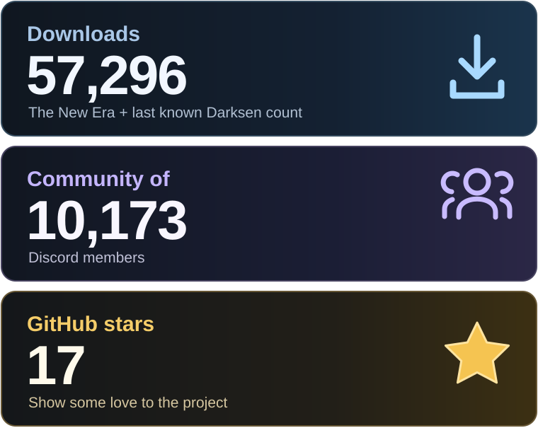

# Ultimate Macro v1.3.3c

Ultimate Macro is a Windows automation tool for Tower Defense Simulator (TDS) on Roblox. It uses AutoHotkey v2, local input automation and image recognition to record and replay strategies.

[Download](https://ultmacro.xyz/download/) · [Setup guide](https://ultmacro.xyz/guide/) · [Wiki](https://ultmacro.xyz/wiki/) · [Discord](https://discord.gg/ultmacro)

## Getting started

1. Download the official [v1.3.3c release](https://github.com/UltimateMacro/Ultimate-Macro-New-Era/releases/tag/v1.3.3c).
2. Extract the entire ZIP to a dedicated folder. Do not run scripts inside the ZIP.
3. Open `Main.ahk` with 64-bit AutoHotkey v2. If AutoHotkey is not installed, run the bundled `submacros/AutoHotkey64.exe` with `Main.ahk` as its script argument, from the extracted folder.
4. Follow the [setup guide](https://ultmacro.xyz/guide/) to configure the macro and Roblox before recording or running a strategy.

## Features

- Strategy recording and replay, including bundled `.strat` examples.
- Farming presets, goals, earnings history, Tower XP and auto-equip tools.
- Discord integration and reporting.
- Appearance settings, themes and localization, including the 10K Party theme.
- Additional tools for supported in-game tasks.

The website's remote Dashboard is currently paused. Check [system status](https://ultmacro.xyz/status/) for service availability.

## Updates and personal files

Download new releases from the official website or this repository's Releases page. Extract each new release into a separate folder and retain your previous installation and custom strategies. The legacy update scripts are included as shipped; they are not the signed 1.4 updater and should not be used for in-place upgrades.

Settings and recordings are stored under `%APPDATA%\Ultimate_Macro`. Back up personal files before changing installations.

## Source layout

| Path | Purpose |
| --- | --- |
| `Main.ahk` | Main application and gameplay logic |
| `lib/` | Shared modules, UI, farming, localization and recognition |
| `submacros/` | Helper scripts and bundled AutoHotkey runtimes |
| `Resources/` | Images, strategies, translations and themes |

CI load-checks the AutoHotkey scripts, validates translation catalogs and checks package file references. These checks do not certify live gameplay.

To contribute, use a separate branch and submit a pull request. Report bugs with the macro version, Windows/display settings, strategy and reproduction steps via [Discord](https://discord.gg/ultmacro).

## Community

## Credits and license

Ultimate Macro was created by **Darksen**, with contributions from the Ultimate Macro developers and community. Preserve the original authors' credits when redistributing modifications. See [LICENSE](LICENSE) for the GNU GPL v3 license. Historical 1.4 development remains in Git history.
